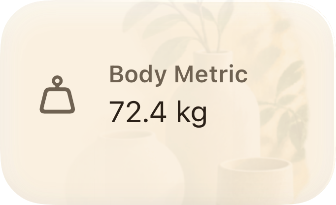

# Ambient artwork in LifeBoard

**Classification:** Implementation guide; current design contract and evidence limits

**Audience:** Product, design, iOS engineering, and QA
**Capability status:** Implemented in the working tree; release validation incomplete
**Source authority:** Runtime symbols linked below, asset manifests, and explicitly identified native evidence
**Last verified:** 2026-09-16 (source audit and representative adapter export; not release certification)

## 1. Rationale and visual hierarchy

The first illustration treatment placed small scenes beside or below card content. Transparent source padding made the painted objects occupy a much smaller area than their image frame. A separate scene row also increased the height of the smallest cards without adding useful information.

The current treatment gives the existing native surface an ambient painted background. The text and controls determine the card's height. Artwork fills those bounds proportionally and is clipped to the owning surface. It neither reserves a reading column nor inserts a footer. Recognition comes from the subject, color relationships, and broad shapes. The primary value, next action, and any privacy or recovery message retain priority.

This is a layering change, not a change to what a card knows. A larger scene cannot imply a completed task, a healthier body, an achieved goal, a logged meal, or a recorded memory. Typography, navigation, control behavior, and shared section-header spacing remain consistent across features. Feature identity does not authorize a special font scale for each header.

## 2. Five Home compositions

User-facing names differ from persisted preset names. Preserve this mapping and existing supported sizes in [the domain registry](../../../Packages/LifeBoardDomain/Sources/LifeBoardDomain/HomeDashboardContracts.swift).

| Visible size | Preset | Minimum height | Native composition intent |
|---|---|---:|---|
| Glance | `compact` | 104 pt | One opening action and essential summary. Full-width background at lower opacity. |
| Compact | `standard` | 178 pt | Primary information and essential controls; supporting details wrap naturally. |
| Wide | `wide` | 178 pt | Native reading and actions use the full width. No reserved illustration column. |
| Story | `tall` | 260 pt | More existing context within the native hierarchy. |
| Expanded | `expanded` | 340 pt | More available rows/evidence, with native grouping and overflow. |

These are height floors, not fixed rectangles or implied aspect ratios. In the current fixed phone fixture, Body Metric Glance is **170.5×104 pt**, Journal Wide is **353×231.5 pt**, and Tasks Compact is **170.5×476.75 pt**. The Tasks height reflects four readable task rows and actions in a narrow column. Artwork does not cause that height. Do not make rows unreadable merely to force a square card.

Glance uses the concise labels “Progress” and “Nutrition” to avoid truncation; the catalog retains “Progress & Reflection” and “Nutrition Summary”.

The production frame planner uses 12-point gaps. Paired narrow cards use half the available content width; a solitary narrow card can widen. A 393-point reference viewport with 20-point content margins yields 353-point full-span content and 170.5-point paired cards. The 834-point tablet fixture yields 794 and 391 points. These isolated fixture values do not establish device safe areas; full-route measurement remains a separate gate.

### Row budgets and interaction priority

[HomeCardPresentationStyle](../../../LifeBoard/DesignSystem/HomeCards/HomeCardPresentationStyle.swift) owns size budgets and minimum heights. Task queues initially expose four rows, or six for Expanded; Low Energy exposes two. Show more still exposes all matching rows and date controls. Care and Routines expose three rows in Compact/Wide, four in Story, five in Expanded, and one in Low Energy. Generic queues use explicit limits of one, two, three, four, and six, capped by available records.

Completion, Undo, refresh recovery, date selection, source opening, and Show more/less remain native interactions. A larger preset may reveal existing records; it must not manufacture a chart or recommendation. Decorative space is never an excuse to hide a recovery action.

### Native examples and annotations

**Native structural fixture, not a generated concept:** the value remains foreground; the entire scene shares the 104-point card height. The title is SF caption semibold, 12 points; the summary uses the 15-point support role. This is not the rounded metric role used by other compositions.

**Native structural fixture:** (1) 16-point reading inset, (2) full-width body copy, (3) Write and Search use their native styles, (4) Weekly reflection retains a 44-point row, (5) artwork passes behind these regions and ends at the rounded surface. Search and Write have different native heights; the reference generator must preserve that difference.

[Generated concepts and rejected revisions](index.html) are labeled separately. A generated image is not evidence that its controls work.

## 3. Artwork architecture

| Collection | Quantity | Purpose | Runtime use |
|---|---:|---|---|
| Home scenes | 44 variants / 22 pairs | Reusable card subjects | Optimized asset catalog images |
| Feature headers | 34 variants / 17 pairs | Distinct panoramic feature identities | Separate optimized asset catalog images |
| UI references | Target: 184 | Visual composition review for 92 supported combinations in two appearances | Never loaded as runtime cards |

[Home manifest](image-generation-manifest.json) retains 228 stable top-level entries: 184 references plus 44 scenes. [Feature manifest](../ambient-surfaces/manifest.json) remains separate. Generation attempts, specification history, acceptance, and native evidence are different records.

### The 22 Home motifs

| Card | Motif | Card | Motif |
|---|---|---|---|
| Setup | Welcoming doorway | Focus Now | Sunlit desk |
| Life Snapshot | Balanced landscape | Care | Botanical alcove |
| Today's Tasks | Paper and pencil | Routines | Garden stepping stones |
| Capacity | Architectural openings | Quick Capture | Open notebook |
| Day Shape | Soft horizon | Journal | Writing nook |
| Progress | Winding landscape path | Active Fast | Ceramic still life |
| Goals | Distant summit | Saved Eva Insight | Violet reading alcove |
| Body Metric | Neutral balanced forms | Workout | Trail and equipment |
| Sleep | Moonlit window | Movement | Walking path |
| Life Moment | Celebratory still life | Nutrition | Kitchen tabletop |
| Recent Meal | Neutral dining vignette | Log Meal | Plate and sketchbook |

These are purpose motifs, not statements about the user's current state. Existing approved people may be retained when compatible with that purpose. Do not introduce a new assistant identity.

### The 17 feature identities

The full authored subjects and appearance palettes are in [feature prompts](../ambient-surfaces/IMAGE_GENERATION_PROMPTS.md). `FeatureHeaderScene` maps Home, Track, Plan, Insights, Eva, Journal, Care, Routines, Goals, Fasting, Body, Workout, Sleep, Movement, Nutrition, Moment, and Capture to separate `AmbientSurface_*Header` assets.

Root headers own one decorative layer. Track's inner section does not repeat the root decoration. Capture attaches artwork to its header/tray surface, so expanding its content does not enlarge the root artwork. Health heroes select the matching body/workout/sleep/movement identity. Journal uses its own identity only when unlocked; Life Moment detail uses its focused moment header.

See [HomeAmbientArtwork](../../../LifeBoard/DesignSystem/HomeCards/HomeAmbientArtwork.swift), [ScreenRootHeader](../../../LifeBoard/Foundation/Navigation/ScreenRootHeader.swift), and [WellnessPresentationComponents](../../../LifeBoard/Features/Health/UI/WellnessPresentationComponents.swift). Shared-header captures establish component rendering; they do not prove all 17 actual routes are correct.

### Layer order and masks

[HomeCardIllustratedSurface](../../../LifeBoard/DesignSystem/HomeCards/HomeCardIllustratedSurface.swift) composes native content over the existing raised clay surface and the scene. [HomeCardScene](../../../LifeBoard/DesignSystem/HomeCards/HomeCardScene.swift) uses proportional `scaledToFill`, trailing alignment, clipping, and a directional opacity mask. The mask's alpha stops are 0.08 at the leading edge, 0.20 at 35%, and 1.0 at the trailing edge. RTL reverses reading protection.

Final scene opacity is 0.18 for Glance, otherwise 0.24 in light appearance and 0.28 in dark appearance, multiplied by that mask. These values describe runtime compositing, not permission for an image generator to paint a darker full-opacity scene into a reference. Compare the resulting image to the native structural capture.

Correct usage: attach a scene to an existing surface, preserve its intrinsic sizing, mask behind reading, and clip to the owner. Incorrect usage: use a transparent 1024-square source with `scaledToFit` as a small trailing thumbnail; add a decorative row to Glance; render the generated UI reference as a flattened card; add decoration at both root and inner header.

## 4. Native content, privacy, and previews

Domain data and routing remain outside the presentation specification. Live adapters pass canonical projection data and callbacks. Preview adapters supply fixed synthetic fixtures and inert callbacks to the same content views. `HomeCardBody` retains its defaulted presentation input. The selected-size placement command retains the existing persistence contract.

The scene visibility policy permits ready and empty content, suppressing unresolved, degraded, unavailable, and redacted content. Supported user media takes precedence. Feature integrations also enforce their local privacy and partial-data rules; these call sites must be checked when introducing a new surface. No artwork may cover a lock explanation or a recovery control.

Glance provides a source-opening action, while specialized cards retain their richer interactions. The placement sheet renders only the selected supported size and identifies the display as a sample. Changing the size updates the preview and selected-size addition command. Draft Save/Cancel, singleton restrictions, distinct source identities, Smart Slots, and ownership remain domain concerns.

Current inert-preview evidence includes disabled hit testing and empty callbacks plus unchanged router/capture state in the adapter comparison test. That is narrower than a complete haptic/timer/network side-effect audit. Application startup work must not be misattributed to a preview.

## 5. Appearance and atmosphere

Canonical light surfaces use paper `#FBF3E2`, cocoa `#2B2118`, and secondary ink `#6F6252`. Dark surfaces use indigo `#282A44`, parchment `#F7F1E7`, and secondary ink `#C9C3B8`. Read exact semantic roles from [DESIGN.md](../../../DESIGN.md) and the token package rather than copying a palette into each feature.

Appearance and daypart are independent inputs. A morning fixture may be dark. A moonlit subject communicates Sleep's purpose; it does not select the app's daypart. Existing atmosphere remains the authority for motion and environmental transitions. Decorative image layers introduce no timers or per-card animation loops.

Increase Contrast, Reduce Transparency, and accessibility text sizes suppress the scene before compromising content. This implementation behavior remains even though this validation pass excludes XXXL and full Dynamic Type sweeps. Default-size RTL, Bold Text, contrast, and motion preference checks remain representative release work.

## 6. Generation and asset operations

### Add or replace a reference

1. Confirm the kind and size exist in the registry. Keep its stable ID; revisions belong beneath it.
2. Export deterministic native content through the explicit evidence command. Record exact copy, typography, element rectangles, fixed flags/sources, and renderer identity. A screenshot alone does not supply machine-readable control geometry.
3. Rebuild the prompt catalog. Uninstrumented entries stay `awaiting-native-elements` and cannot be dispatched by the submission helper.
4. Specify logical points, integer final export at four pixels/point, multiple-of-16 canvas, and exact card rectangle. Center padding for unusually wide/tall cards within a 1:3–3:1 canvas. Do not reinterpret grid spans as aspect ratios.
5. Run `prepare_home_card_generation.py ID --revision-reason '…'`. It freezes the prompt, input references/hashes, dimensions, revision, and timestamp **before** built-in generation.
6. Dispatch the frozen prompt and named files to the built-in tool. Save every successful result immediately through `record_home_card_generation.py ID SOURCE --submission FILE`. Record a failure with `--failure` instead of losing the attempt.
7. The source-built exporter maps the requested card rectangle uniformly into actual output, removes intentional padding, and records any subsequent crop. It rejects more than 4% unintended correction. Inspect essential clipping independently; passing the numeric limit does not prove a usable composition.
8. Review source and exact export beside native structure. Record acceptance/rejection using `inspect_home_card_reference.py`. After two unsuccessful targeted revisions, flag design review and change the hypothesis before retrying. Do not loosen acceptance just to advance a count.
9. Refresh the gallery and run the read-only validator. Native acceptance remains separate from generated concept acceptance.

Submissions are immutable files; the manifest uses a shared filesystem lock and atomic replacement for catalog/generation/inspection operations. Helpers compile from checked-in Swift source plus compiler version into `build/design-tools`, avoiding dependence on an undocumented temporary executable. Failed exports retain originals but remove stale current exports.

### Add or replace production artwork

1. Define a purpose-specific subject without text, numbers, progress marks, charts, buttons, or UI chrome. Author both appearances. Keep Eva violet in assistant contexts.
2. Preserve the original tool output under `DesignAssets/Sources/…`; normalize a separate canonical PNG with true alpha. Inspect alpha edges and the actual painted area, not only the image dimensions.
3. Home sources use a documented 1024-square canonical canvas; runtime exports crop visible alpha bounds with 24 source pixels of clearance. Scale the painted crop proportionally to 256/512/768-pixel maximum edges. Do not stretch it.
4. Feature sources use panoramic canonical 1536×512 exports, then proportional 512×171, 1024×342, and 1536×513 runtime images. Fractional aspect differences are accommodated by transparent padding.
5. Run the corresponding packager. Home packaging exposes only complete accepted appearance pairs and rebuilds its owned directory. Validate source/runtime hashes and reproduce the runtime bytes in a second run. Preserve unrelated asset catalogs.
6. Check the actual route or card, including privacy/media precedence and dark appearance. An attractive isolated illustration is insufficient evidence of a readable header.

Production artwork was previously accepted, but ongoing composition review can reveal missed constraints. Checklist-like marks found in the Tasks dark source were removed in a 2026-09-16 revision; the original and inspection evidence remain archived. Historic acceptance must not conceal a newly identified problem.

### Loading and performance

[HomeSceneImageCache](../../../LifeBoard/DesignSystem/HomeCards/HomeSceneImageCache.swift) coalesces in-flight preparation and reuses prepared images by asset and appearance. Its `NSCache` has a 32 MiB cost limit and 48-object count limit. These are eviction policies, not a hard bound on total process memory: mounted views and in-flight tasks can retain images separately.

The runtime loads optimized asset names, never original generation paths or generated UI mockups. Do not decode source PNGs during body recomputation, introduce blur/offscreen effects for every card, or attach an independent animation loop to decoration. When adding collections, budget decoded pixels and mounted-image retention as well as compressed download size.

## 7. Verification and known limits

On 2026-09-16 the explicit native adapter/preview export produced 68 configurations and 136 images with matching heights. [Measurements](live-preview-measurements.json) and [gallery](index.html) identify the sampled combinations. This covers all 22 kinds through chosen sizes, six extra phone cases, six tablet cases, and both appearances. It uses the production card adapter in isolation; it is not a full `AdaptiveHome` screenshot or comprehensive behavior proof.

Earlier evidence includes 368 isolated structural captures and 34 shared-header captures. They remain supporting evidence. Full-Home paired/solitary/mixed/Low Energy placement, 17 actual feature routes, all functional scenarios, broad-suite classification, target membership, and complete cold/warm performance comparisons remain release gates until linked results establish them.

Historical scripted scrolling checks passed and reported CPU/peak-memory values. They did not emit frame-hitch/FPS measurements. Do not advertise a speedup or smoothness guarantee from elapsed scripted duration. The agreed comparison requires matching fixtures/device/build settings, three cold and three warm cycles, and investigation of repeatable >10% CPU/memory increases.

The pass excludes XXXL, Dynamic Type sweeps, exhaustive preset behavior tests, system WidgetKit redesign, Watch visual redesign, and Live Activities. Shared implementation coverage must be labeled as such; unsampled presets are not directly verified.

For current counts and blockers, consult [VALIDATION](VALIDATION.md), [active tracker](COMPLETION_TODO.md), and manifests. Future ideas are in the explicitly [unimplemented creative directions](FUTURE_CREATIVE_DIRECTIONS.md); they do not change this contract.

## Evidence rendering details

Offscreen structural captures retain their prepared scene explicitly for the duration of rendering. The bounded cache can evict at any time; cache residency is not a reliable capture prerequisite. This retention belongs to the optional evidence recorder and does not increase production cache budgets. Value and unit geometry from the package `NumericRoll` is exported through a DEBUG-only SPI, leaving the released component API unchanged.

Narrow ring cards must preserve their explanatory words. The shared Setup/Goals composition uses a 130-point minimum reading block beside the ring and stacks when that block cannot fit. The amount of recorded progress remains the projection's value. The scene does not determine progress or completion.

The native Home linear progress style draws its track in SwiftUI. It adds no animation loop, keeps the native ProgressView contract, and can be rendered by the explicit structural exporter. These implementation details still require the representative evidence gates listed in the validation report.
